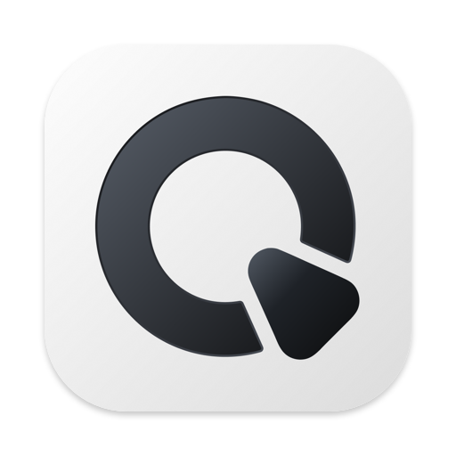
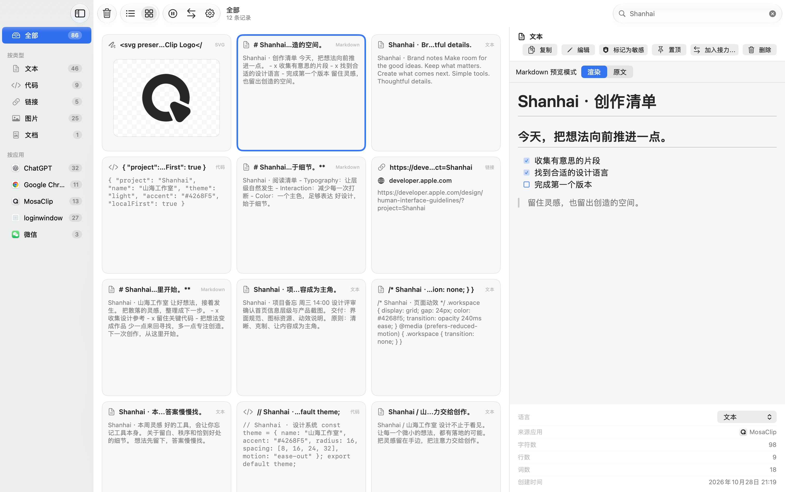
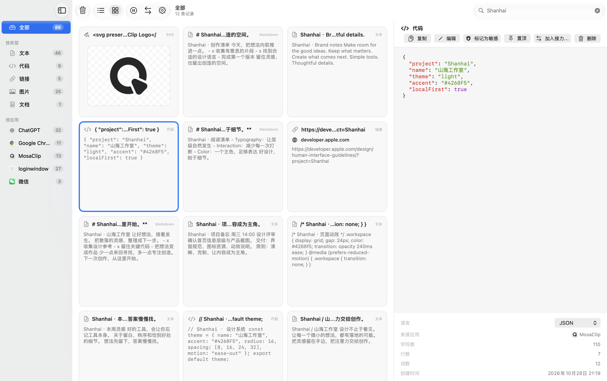
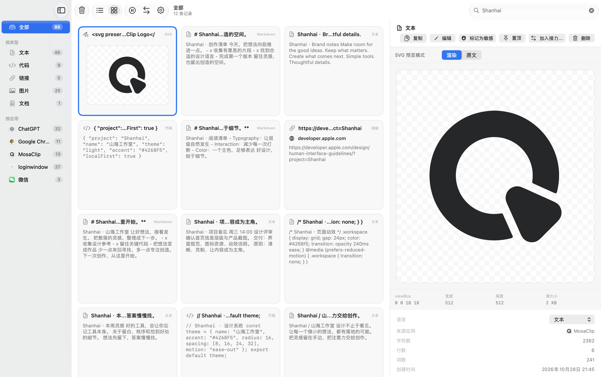

# MosaClip



**macOS 本地剪贴板工作区。**

把复制过的文字、图片、链接和文件放在一起。在卡片中找到片段，在详情中阅读，
再复制、粘贴或转换；原始剪贴板内容始终保留。

[English](README.md) · [下载版本](https://github.com/mumulei/MosaClip/releases) · [反馈问题](https://github.com/mumulei/MosaClip/issues)



## 从历史记录到工作区

MosaClip 是基于 PasteMemo 开发的 macOS 剪贴板管理工具。在原项目的剪贴板、
搜索、OCR 和粘贴能力之上，增加了用于浏览、阅读与处理内容的工作区。

| 功能 | 可以做什么 |
| --- | --- |
| 历史记录 | 捕获文字、图片、文件与富文本；全文搜索，按类型或来源应用筛选，置顶常用内容。 |
| 卡片与列表 | 在紧凑卡片网格和原生列表之间切换，多选记录，在右侧查看详情。删除卡片后连续补位。 |
| 内容预览 | Markdown 渲染与原文切换、SVG 与源码查看、代码高亮、颜色色板、图片缩放及支持的媒体和文件预览。 |
| 快捷面板 | 用全局快捷键打开历史，通过键盘搜索、粘贴或执行快捷操作。 |
| 接力粘贴 | 将多条记录加入队列，按顺序粘贴；也可以把文本拆分成队列。 |
| OCR 与提取 | 识别图片中的文字、粘贴识别结果，从支持的内容中提取链接或验证码。 |
| 自动化 | 自动或手动运行规则，清理 URL、转换文本、设置元数据；选择生成新记录、存入文件夹或发送至已配置 Webhook 等结果去向。 |
| 存储管理 | 按来源、类型、时间查看占用与清理历史；TIFF 原图无损转 PNG；导入、导出包含原图的备份。 |
| 隐私控制 | 忽略指定应用、遮罩敏感内容，设置历史保留和敏感条目过期时间，随时暂停捕获。 |
| 工具集成 | 按需启用本地 MCP 桥接，连接兼容的 Agent 客户端；使用已打包的 macOS App Intents。 |

### 阅读内容，保留原始数据

主窗口详情支持 Markdown 渲染、代码高亮和 SVG 查看。预览只是展示形式，不会
替换复制、粘贴使用的原始数据。Markdown 与 SVG 预览不会自动请求远程资源。





以上为使用演示内容的 MosaClip 实机截图，已替换原 PasteMemo 的产品截图。
快捷面板中的内联 Markdown 和 OCR 使用原生文本；Markdown 渲染与原文切换位于主窗口。

## 开始使用

1. 打开 MosaClip，选择是否捕获剪贴板变化。处理敏感内容前，先在设置中检查忽略应用和保留策略。
2. 复制一段内容，在主窗口中浏览卡片，或切换到列表。
3. 按 **⌘⇧V** 打开快捷面板，搜索并选中记录，按 **回车** 粘贴。
4. 如需向其他应用自动粘贴，请授予辅助功能权限；覆盖安装后可能需要重新授权。

### 常用快捷键

除全局呼出快捷键外，下列操作适用于快捷面板。全局快捷键可以在设置中修改。

| 快捷键 | 操作 |
| --- | --- |
| ⌘⇧V | 打开／关闭快捷面板 |
| ↑ / ↓、Ctrl+P / Ctrl+N | 浏览历史 |
| ⌘1 … ⌘9 | 粘贴对应记录 |
| 回车 | 粘贴选中项 |
| ⇧回车 | 粘贴并回车 |
| ⌘K | 打开快捷操作 |
| ⌘F | 聚焦搜索 |
| Esc | 关闭面板 |

## 0.5.0 公开源码版

[产品官网](https://mumulei.dpdns.org/mosaclip/) · [源码版本](https://github.com/mumulei/MosaClip/releases/tag/v0.5.0)

完整源码、测试与构建说明现以 GPL-3.0 公开，要求 macOS 14 或更高版本。
正式 DMG 下载将在 Developer ID 签名与 Apple 公证完成后提供。
在线更新和匿名统计保持关闭。安装自行构建的版本前，请备份历史记录。
相对于 MosaClip 0.4.7，没有数据库结构变更。[发布说明](docs/RELEASE_NOTES_0.5.0.md)。

## 本地数据与可选连接

剪贴板历史存储在本机。MosaClip 没有内置云端 AI 提供商，也不会自动把历史发送给 LLM。
设置中的 **AI Agents** 用于配置可选的本地 MCP 桥接，默认关闭，并默认排除敏感条目。
连接的外部客户端如何处理数据，由该客户端的策略决定。

本地存储不意味着所有功能都离线：网页预览、主动打开的链接和自行配置的 Webhook 规则，
可能访问对应网络地址。处理私密内容前，请检查这些功能的使用方式。

## 构建与参与开发

需要 macOS 开发环境、兼容 Swift 6 的工具链和 macOS SDK。

```bash
git clone https://github.com/mumulei/MosaClip.git
cd MosaClip
swift build
swift test
make check
```

本地开发可运行 `make dev`，在源码变化后重新构建并启动。
请使用任务专属分支，并遵循 [AGENTS.md](AGENTS.md)。

打包本地 QA 候选包时，明确指定尚未使用的归档目录：

```bash
make package VERSION=0.5.0 ARCH=arm64 SIGNING_MODE=adhoc \
  DIST_DIR="dist/qa/<source-sha>-<candidate-id>"
```

请一起保留 App、DMG、校验值及构建来源记录，不覆盖已验收归档，也不要通过重新构建
来更新根目录 `dist/`。正式分发需要独立的 Developer ID、公证与 Gatekeeper 验证流程，见
[分发说明](docs/MOSACLIP_DISTRIBUTION.md)。

更多文档：[上游与源码来源](docs/UPSTREAM.md)、
[第三方声明](THIRD_PARTY_NOTICES.md)。

## 感谢 PasteMemo

MosaClip 基于 **[lifedever / PasteMemo-app](https://github.com/lifedever/PasteMemo-app)** 开发。
感谢原作者 lifedever 与上游贡献者将项目开源，提供了剪贴板捕获、持久化、OCR 和粘贴等基础能力，
让 MosaClip 能够在此之上继续发展本地工作区。MosaClip 是独立维护的衍生项目。

本项目采用 **[GPL-3.0](LICENSE)**。原作者版权与第三方声明保留在源码及应用包中。

© 2026 lifedever and MosaClip contributors.
